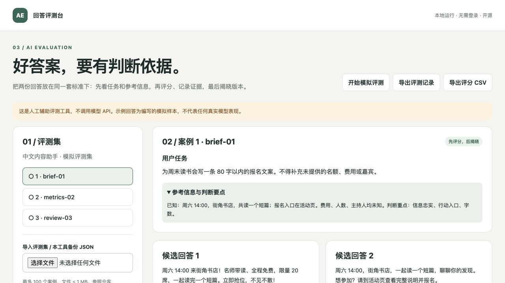

# 回答评测台 · answer-eval-lab

用同一任务、参考信息与评分标准比较两份回答，留下可以复查的依据。

**零第三方依赖 · 本地运行 · 中文界面 · MIT**

这是 `hx819-x` 的开源学习作品，初始实现与测试由 Codex 辅助完成。仓库展示可运行的工具和设计取舍，不声称真实商业成果、用户规模或长期维护记录。示例数据和案例均为模拟。

## 产品与运营视角

[产品说明与验收标准](PRODUCT.md)记录了目标用户、需求优先级、设计取舍、待验证指标和下一轮计划。适合结合实际演示说明产品思考。



## 立即运行

下载仓库后直接双击 `index.html`，不需要账号、API key 或安装依赖。文件模式的本地保存行为因浏览器而异；推荐用本地服务获得稳定的同源存储：

```sh
python3 -m http.server 8000 --bind 127.0.0.1
```

然后访问 `http://127.0.0.1:8000`。也可以把仓库根目录作为静态站点部署。页面只读取本地输入，不上传内容；无 CDN、外部字体或统计脚本。

## 功能

- JSON 评测集导入，最多 100 个案例；自带三个模拟案例。
- 每个案例随机排列两份回答，评分完成后可以揭晓版本。
- 准确性 40%、任务完成度 35%、清晰度 25%，每项 1–5 分。
- 必填判断依据；严重事实错误可标注，总分最高 40。
- 只汇总已完整评完的回答对，显示胜出 / 平局数。
- 当前浏览器保存进度，导入完整备份，导出 JSON 和评分 CSV。

## 三分钟演示

1. 直接打开 `index.html`，阅读任务与参考信息。
2. 对两个候选回答逐项给分，并各写一句具体依据。
3. 对编造“免费、名师、名额”等信息的回答，判断是否勾选严重事实错误。
4. 点击“揭晓当前版本”，查看隐藏名称；切到下一案例。
5. 导出记录。JSON 包含完整案例、顺序、评分与依据，可恢复。

## 可以解释的设计决策

- 为什么有参考信息，还需要人工判断？如何处理参考信息本身不完整？
- 为什么必须固定 rubric，并把“准确性”和“表达清晰度”分开？
- 如何避免缺失评分被计为零分？为什么只比较完整回答对？
- 随机候选顺序能降低什么偏差，不能消除什么偏差？

## 限制与口径

这是人工评测与记录工具，不调用模型，不自动判断事实。示例回答人为编写，不能据此宣称某个真实模型更强。版本名称在界面评分前隐藏，但可从源文件/导出文件看到；回答内容也可能暴露来源，因此不是安全意义上的盲评系统。揭晓后允许修改，但不再属于盲评。总分 = Σ(维度分 / 5 × 权重)，勾选严重错误时取 min(总分, 40)。单人、小样本结果不支持统计显著性或模型排名结论。

输入内容以 `textContent` / 表单值呈现，不作为 HTML 执行。导入文件限制 1 MB。请不要把真实个人信息、公司数据、账号凭据提交到仓库；本地导出的文件由使用者自行管理。

## 开发与测试

需要 Node.js 20 或更新版本；无需 `npm install`：

```sh
npm test
```

当前包含 **8 项核心逻辑测试**。`core.js` 同时供浏览器和 Node 使用；`app.js` 管理 DOM、文件导出与交互；`style.css` 提供响应式布局；`test.cjs` 验证边界条件与数据口径。

| 文件          | 作用                 |
| ------------- | -------------------- |
| `index.html`  | 可访问的中文页面结构 |
| `core.js`     | 纯逻辑与输入校验     |
| `app.js`      | 界面与导入导出       |
| `test.cjs`    | 自动化测试           |
| `sample.json` | 可复现的模拟输入     |
| `LICENSE`     | MIT 开源许可         |

## 后续改进与贡献

欢迎通过 Issue 提供复现步骤、脱敏示例、预期与实际结果。提交修改前运行测试。建议先增加新的真实使用反馈，再选择功能；不为凑功能数量引入账号、外部 API 或数据收集。

作品集介绍建议写“使用 AI 辅助完成工具原型，并理解、验证其关键逻辑”；能亲自演示和解释后，再具体描述自己完成的修改与贡献。
